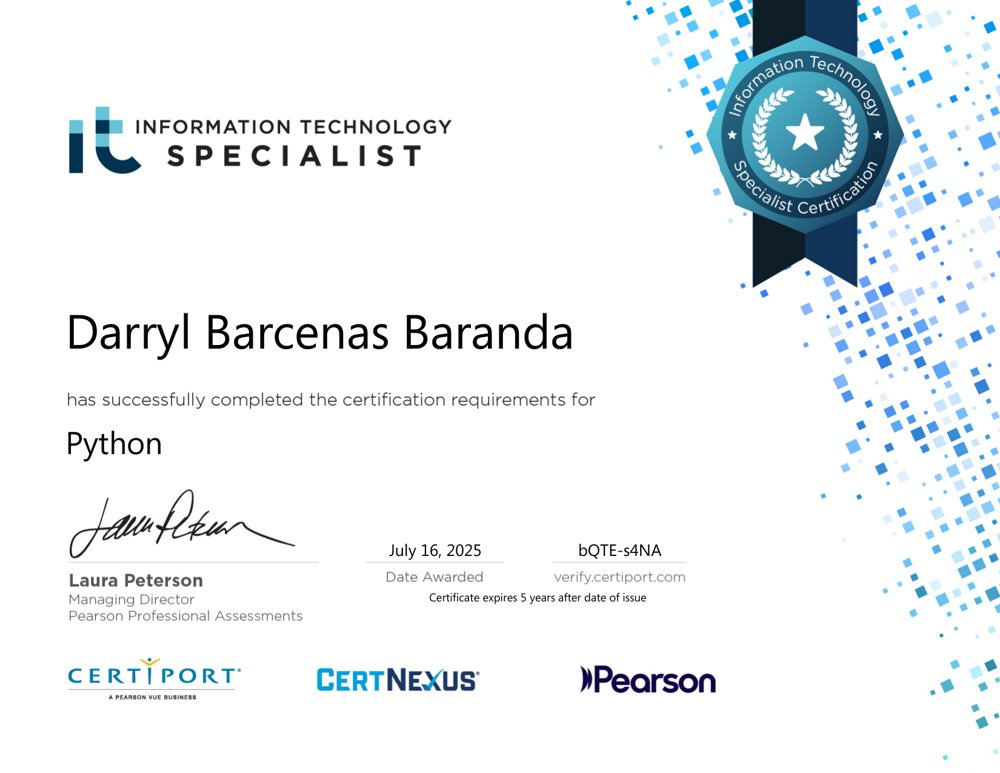
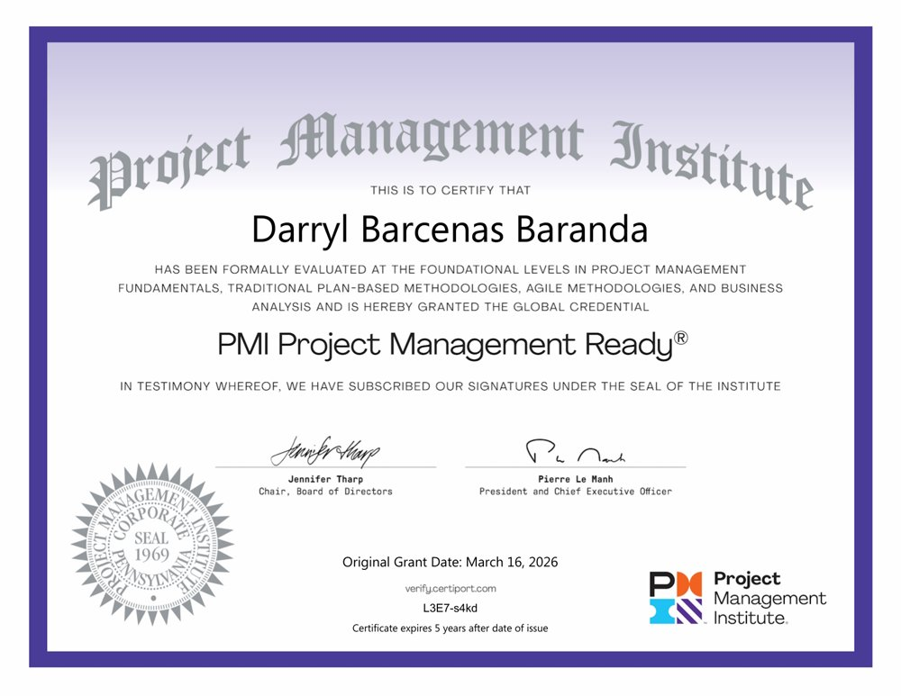
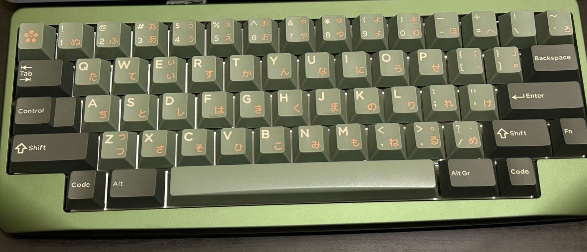

<h1 align="center">Hi, I'm Darryl 👋</h1>

  <b>CS student from Manila, always curious about how things work under the hood.</b> 
  In my free time I play JRPGs and Magic: The Gathering,
  and I'm a custom HHKB-layout keyboard enjoyer.

  
  

---

### About me

- 🔍 I like taking things apart to see how they work, which is how I ended up studying computer science for college :>
- 🃏 I get obsessed with a hobby, then start writing code to fix the tiny things that annoy me about it
- 🌾 I like building for real people, from banana farmers (my thesis) to students without reliable internet (Kulay)
- 🧪 I'm the teammate who tests everything twice; I led QA on my thesis and like getting things right the first time rather than the second time
- 🤝 Most of my best work was built with a team, and I'm usually the one listening first and keeping things level
- 🎸 Currently learning guitar in my free time!!!
- 🌱 Looking for a software development internship

### Featured projects

| Project | What it is | Built with |
| --- | --- | --- |
| [**Lotus**](https://github.com/darilexe/lotus-lang) | A Magic: The Gathering–inspired programming language with its own compiler (lexer, parser, semantic analysis, scoped symbol table) and a card-based IDE | Python · Tkinter · Pillow |
| [**S-Aging**](https://github.com/yoellil/S-aging) | Undergraduate thesis: detects diseased regions on banana leaves and simulates how the disease spreads, on a 3D leaf and across a 2D plantation | Python · FastAPI · YOLOv11 · PyVista · React |
| [**Kulay / KodigNo**](https://github.com/yoellil/Kulay) | Offline reading lab and AI study assistant for Grade 1–12 learners: turns photos, PDFs and notes into quizzes and flashcards with a local AI model, no internet needed | Dart · Flutter · Drift (SQLite) · llama.cpp |
| [**OnlyCars**](https://github.com/darilexe/OnlyCars) | Car dealership desktop app: browse and buy with a loan calculator, or sell your car for a mileage-based offer | Java · Swing |
| [**Birthday Congruence Analyzer**](https://github.com/darilexe/birthday-congruence-analyzer) | Finds which birthdays fall on your birth weekday using modular arithmetic, no calendar library | Python · Tkinter |

### Tech I work with

**AI tools I use**

### Certifications

<table>
  <tr>
    <td align="center" width="50%">
       
      <b>Information Technology Specialist – Python</b> 
      Certiport · July 2025 · Score 960/1000 
      Verify at <a href="https://verify.certiport.com">verify.certiport.com</a> with code <code>bQTE-s4NA</code>
    </td>
    <td align="center" width="50%">
       
      <b>PMI Project Management Ready®</b> 
      Project Management Institute · March 2026 · Score 980/1000 
      Verify at <a href="https://verify.certiport.com">verify.certiport.com</a> with code <code>L3E7-s4kd</code>
    </td>
  </tr>
</table>

### My daily driver ⌨️

| Part | What I used |
| --- | --- |
| Case / Layout | KBDFans Agar, aluminum plate (Pine Green, HHKB layout) |
| Switches | Keygeek Y2 (48g) |
| Keycaps | Domikey x Inky Silent Forest |
| Stabilizers | Typeplus x YKIB screw-in, tuned and lubed with Krytox 205g0 and XHT-BDZ |
